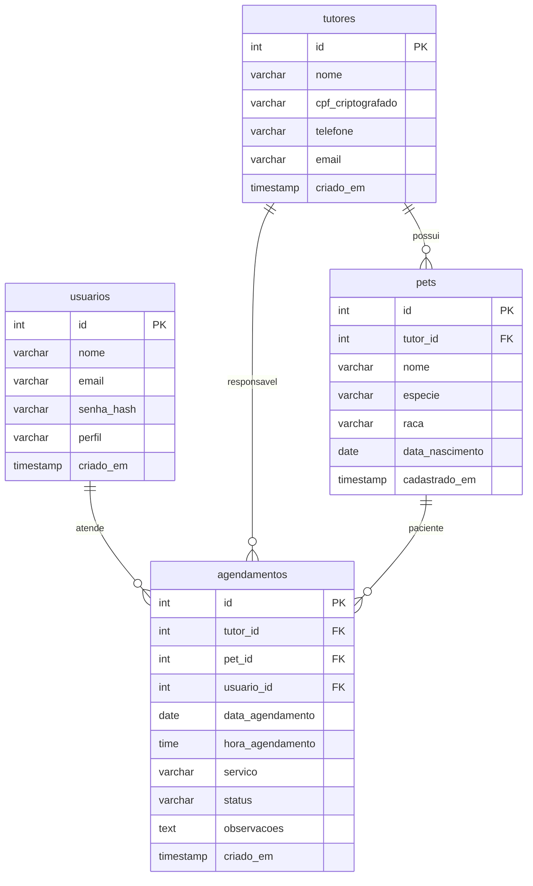

# SisVet

SisVet é uma aplicação web desenvolvida para a gestão e rotina diária de uma clínica veterinária. O sistema organiza o atendimento em recepção e consultório, permitindo cadastrar tutores, registrar animais vinculados e gerenciar a agenda de consultas e procedimentos.

O projeto foi construído para a prova prática do SAEP (Técnico em Desenvolvimento de Sistemas), atendendo aos requisitos de integridade relacional no banco de dados, proteção de dados sensíveis (LGPD) e controle de sessão por inatividade.

## Como executar

Para rodar a aplicação localmente, você precisa do PHP 8.2 ou superior (com a extensão `pdo_pgsql` habilitada) e do PostgreSQL em execução.

1. Banco de dados

   Crie a base e execute o script SQL com a estrutura e os dados de teste:

   ```bash
   createdb -U postgres saep_veterinario
   psql -U postgres -d saep_veterinario -f saep_db.sql
   ```

   O script cria as quatro tabelas do sistema e insere uma carga inicial para testes. Caso utilize outro nome ou porta para o banco, ajuste o arquivo `sistema/config/database.ini`.

2. Servidor web local

   Acesse a pasta do sistema e inicie o servidor interno do PHP:

   ```bash
   cd sistema
   php -S localhost:8000 -t public
   ```

3. Acesso

   Abra o navegador no endereço `http://localhost:8000/login`.

## Usuários de teste

O banco já vem com três perfis cadastrados para avaliação de diferentes fluxos da rotina:

| Nome | E-mail | Perfil | Senha |
| :-- | :-- | :-- | :-- |
| Dra. Camila Alencar | `camila.vet@sisvet.com` | Veterinária | `123456` |
| Lucas Fernandes | `lucas.recepcao@sisvet.com` | Recepção | `123456` |
| Mariana Rocha | `gestao@sisvet.com` | Administrador | `123456` |

## Funcionalidades e regras de negócio

A aplicação atende aos critérios do exame prático com as seguintes diretrizes:

- Autenticação e sessão: login com conferência de hash (bcrypt) e controle de inatividade. A sessão expira automaticamente após 15 minutos sem uso. O encerramento de sessão (logout) limpa as variáveis e invalida o cookie de sessão via POST.
- Tutores e proteção de dados (LGPD): listagem com busca dinâmica (por nome, e-mail ou telefone), cadastro, edição e exclusão com remoção em cascata. O CPF do tutor é cifrado com AES-256-CBC antes de ir para o banco, sendo decifrado apenas na camada de serviço para operadores autorizados.
- Animais (Pets): cada pet exige obrigatoriamente a seleção de um tutor já cadastrado (relação 1:N). A listagem traz o nome do animal, espécie, raça, data de nascimento e os contatos do tutor.
- Agendamentos: lista ordenada cronologicamente por data e horário, contendo o animal, tutor e procedimento agendado. Inclui formulário para novas consultas e fluxo específico para remarcação de data e horário.

## Estrutura técnica

- Padrão arquitetural: MVC (Model-View-Controller) com Repository Pattern. Os controllers recebem requisições HTTP e definem respostas; as classes em `src/Repository` concentram todas as operações PDO com Prepared Statements; as views cuidam do HTML.
- Segurança: Prepared Statements contra SQL Injection, `htmlspecialchars()` em saídas dinâmicas contra XSS, tokens CSRF em formulários de alteração e exclusão, e cifra AES-256-CBC para documentos sensíveis.
- Autoload: padrão PSR-4 gerenciado via Composer (`namespace VetVida\`).
- Interface: Bootstrap 5 e Bootstrap Icons com folha de estilo customizada para cores sóbrias e sem decorações excessivas.

## Modelo de dados (DER)

Diagrama de entidades e relacionamentos em notação Mermaid:



### Regras de relacionamento

1. Um tutor pode ter vários pets cadastrados. Todo pet pertence obrigatoriamente a um tutor (`tutor_id NOT NULL`).
2. O tutor é a referência de contato e cobrança nos agendamentos.
3. Cada agendamento aponta para o pet que receberá o atendimento.
4. O usuário do sistema (veterinário ou atendente) registra e conduz o agendamento.

## Organização de pastas

```
saep_veterinario/
├── README.md
├── saep_db.sql
└── sistema/
    ├── composer.json
    ├── config/
    │   └── database.ini
    ├── public/
    │   └── index.php
    ├── src/
    │   ├── Core/
    │   │   ├── Database.php
    │   │   └── Router.php
    │   ├── Security/
    │   │   ├── CryptoService.php
    │   │   └── SessionManager.php
    │   ├── Repository/
    │   │   ├── UsuarioRepository.php
    │   │   ├── TutorRepository.php
    │   │   ├── PetRepository.php
    │   │   └── AgendamentoRepository.php
    │   ├── Controller/
    │   │   ├── BaseController.php
    │   │   ├── AuthController.php
    │   │   ├── DashboardController.php
    │   │   ├── TutorController.php
    │   │   ├── PetController.php
    │   │   └── AgendamentoController.php
    │   └── Views/
    │       ├── layout/
    │       ├── auth/
    │       ├── dashboard/
    │       ├── tutores/
    │       ├── pets/
    │       └── agendamentos/
    └── vendor/
```

## Dados de entrega

- Estudante: Eduardo Lucas Garcia
- Curso: Técnico em Desenvolvimento de Sistemas
- Avaliação: Prova Prática SAEP
